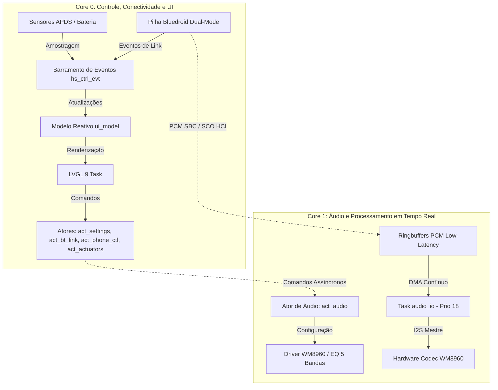

# HeadSet4 — Smart Cyberpunk Hi-Fi Wireless Headset

> **Headset Bluetooth Inteligente de Alta Fidelidade com Interface Gráfica Touchscreen Integrada, Detecção de Uso e Expressividade Háptica.**  
> Projetado para o SoC **ESP32-WROVER-E** utilizando **ESP-IDF v6.x**, **FreeRTOS SMP Dual-Core** e **LVGL 9**.

---

## 🎧 Visão Geral do Projeto

O **HeadSet4** é um dispositivo de áudio vestível (*wearable*) autônomo e de código aberto que combina a reprodução sonora estéreo de alta fidelidade com uma interface gráfica colorida sensível ao toque diretamente na concha do fone, eliminação de controles cegos, comutação inteligente entre múltiplos dispositivos e automação baseada em sensores de presença.

```
       ┌────────────────────────────────────────────────────────┐
       │             HeadSet4 Smart Wearable System             │
       ├────────────────────────────────────────────────────────┤
       │  [ LCD TFT 2.8" Touch ] ── ILI9341 + XPT2046 (SPI3)    │
       │  [ Codec Hi-Fi WM8960 ] ── 24 MHz MCLK, I2S0 DMA, I2C0  │
       │  [ Sensor APDS-9930   ] ── Detecção Óptica de Uso       │
       │  [ Conectividade BT   ] ── Dual-Slot + Fast/Swift Pair │
       │  [ Controle Remoto    ] ── Companion App Android (BLE) │
       │  [ Resposta Tátil     ] ── Motor Háptico Vibracall     │
       └────────────────────────────────────────────────────────┘
```

### Principais Funcionalidades

- **Interface Visual Direta no Fone:** Display LCD TFT colorido de 2,8" sensível ao toque ([display.c](file:///a:/BackupDesktopFileBruno/Estudos/ESP/ESP32/headSet4/main/src/display/display.c)) com 11 telas interativas renderizadas em tempo real com **LVGL 9** sob arquitetura reativa MVVM.
- **Áudio Hi-Fi Dedicado:** Codec estéreo de alta fidelidade [wm8960.c](file:///a:/BackupDesktopFileBruno/Estudos/ESP/ESP32/headSet4/main/src/audio/wm8960.c) (Cirrus Logic/Wolfson) com oscilador local a cristal de 24 MHz acoplado ao PLL interno, amplificador classe D/AB e entrada para microfone analógico.
- **Equalizador Paramétrico de 5 Bandas:** Processamento digital de sinal (DSP em [eq.c](file:///a:/BackupDesktopFileBruno/Estudos/ESP/ESP32/headSet4/main/src/audio/eq.c)) com ganho ajustável de -12 dB a +12 dB em passos de 0,5 dB diretamente pela tela ou via aplicativo móvel.
- **Detecção de Uso na Cabeça (*Wear Detection*):** Sensor óptico infravermelho [apds9930.c](file:///a:/BackupDesktopFileBruno/Estudos/ESP/ESP32/headSet4/main/src/sensor/apds9930.c) com algoritmo de histerese dinâmica ($th_{\text{off}} = 0{,}6 \cdot th_{\text{on}}$). Pausa a mídia e desliga o backlight ao retirar o fone; retoma a reprodução e reativa o display ao colocá-lo novamente.
- **Conectividade Multiponto Dual-Slot:** Gerenciador multiponto em [bt_link_mgr.c](file:///a:/BackupDesktopFileBruno/Estudos/ESP/ESP32/headSet4/main/src/bt/bt_link_mgr.c) mantendo conexão simultânea com dois dispositivos (ex: Computador e Smartphone) com *Auto-Switching* inteligente (prioridade de chamadas telefônicas sobre música).
- **Pareamento Moderno em 1 Toque:** Suporte integrado a **Google Fast Pair** (pop-up com Anti-Spoofing ECDH P-256 e AES-128 em [bt_fastpair.c](file:///a:/BackupDesktopFileBruno/Estudos/ESP/ESP32/headSet4/main/src/bt/bt_fastpair.c)) e **Microsoft Swift Pair** para Windows 10/11.
- **Voz HD e Comunicação Telefônica:** Perfil HFP 1.7 ([bt_hfp.c](file:///a:/BackupDesktopFileBruno/Estudos/ESP/ESP32/headSet4/main/src/bt/bt_hfp.c)) com codec mSBC a 16 kHz (Wide Band Speech) e algoritmo de supressão de ruído no microfone ([voice_nr.c](file:///a:/BackupDesktopFileBruno/Estudos/ESP/ESP32/headSet4/main/src/audio/voice_nr.c)).
- **Expressividade Háptica & Animatrônica:** Motor de vibração háptico (Vibracall no GPIO 15) com envelopes temporizados para cliques táteis, alertas e chamadas ([actuators.c](file:///a:/BackupDesktopFileBruno/Estudos/ESP/ESP32/headSet4/main/src/actuators/actuators.c)).
- **App Companion BLE:** Canal de telemetria e comando bidirecional estruturado em JSON sobre Bluetooth Low Energy ([phone_ctl.c](file:///a:/BackupDesktopFileBruno/Estudos/ESP/ESP32/headSet4/main/src/bt/phone_ctl.c)).

---

## 🎯 Diferenciais de Engenharia

| Recurso | Fones Comerciais Convencionais | HeadSet4 (Este Projeto) |
| :--- | :---: | :---: |
| **Interface com Usuário** | Apenas bips sonoros e LEDs de status | **Display LCD 2,8" Touchscreen Colorido (240x320) com LVGL 9** |
| **Arquitetura de Áudio** | SoCs com DACs internos limitados | **Codec Dedicado Cirrus WM8960 + MCLK de 24 MHz + I2S DMA** |
| **Equalização** | Presets fixos e fechados em app | **5 bandas paramétricas (-12 a +12 dB) em passos de 0,5 dB** |
| **Sensor de Presença** | Restrito a modelos de alto custo | **Sensor infravermelho APDS-9930 com histerese dinâmica anti-repique** |
| **Conexão Multiponto** | Requer desconexão manual ou app fechado | **2 slots Classic simultâneos com Auto-Switching determinístico** |
| **Pareamento Rápido** | Exclusivo de ecossistemas fechados | **Google Fast Pair e Microsoft Swift Pair nativos** |
| **Telemetria de Bateria** | Porcentagem aproximada em degraus | **ADC1_CH6 calibrado com chaveamento MOSFET anti-fuga** |
| **Arquitetura de Código** | Firmware proprietário monolítico | **Arquitetura modular em Micro-Atores e Separação Dual-Plane** |

---

## 🛠️ Especificações de Hardware e Pinagem

O sistema é construído ao redor do módulo **ESP32-WROVER-E** (SoC ESP32-D0WD-V3, 8 MB de PSRAM Quad-SPI e 16 MB de Flash SPI), operando a 240 MHz com alimentação de 3,3 V regulada.

```
                                  ESP32-WROVER-E
                       (Dual-Core Xtensa LX6 @ 240 MHz + 8 MB PSRAM)
                                        │
        ┌───────────────────────────────┼───────────────────────────────┐
        ▼                               ▼                               ▼
[ Barramento I2S0 + I2C0 ]      [ Barramento SPI3 (VSPI) ]      [ Sensores & Atuadores ]
  - Codec WM8960 (I2C 0x1A)       - Display ILI9341 (40 MHz)      - APDS-9930 (I2C 0x39)
  - Cristal local de 24 MHz       - Touch XPT2046 (1.5 MHz)       - Bateria (ADC1_CH6 + MOSFET)
  - Áudio Estéreo SBC / mSBC      - Backlight PWM (LEDC GPIO 13)  - Vibracall Háptico (GPIO 15)
  - Microfone com Voice NR                                        - Botão Multifunção (GPIO 0)
```

### Tabela de Mapeamento de GPIOs ([main/src/board/pinout.h](file:///a:/BackupDesktopFileBruno/Estudos/ESP/ESP32/headSet4/main/src/board/pinout.h))

| Periférico | Sinal | GPIO | Barramento | Observações e Restrições Elétricas |
| :--- | :--- | :---: | :--- | :--- |
| **Display LCD** | `LCD_SCLK` | **18** | SPI3 (VSPI) | Clock nativo IOMUX a 40 MHz (compartilhado com touch) |
| **Display LCD** | `LCD_MOSI` | **23** | SPI3 (VSPI) | MOSI nativo IOMUX (compartilhado com touch) |
| **Display LCD** | `LCD_CS` | **5** | SPI3 (VSPI) | Chip Select do LCD (pino de strapping, pull-up de 10 kΩ) |
| **Display LCD** | `LCD_DC` | **27** | GPIO | Seleção Comando/Dados do ILI9341 |
| **Display LCD** | `LCD_RST` | **4** | GPIO | Reset físico do controlador de display |
| **Backlight** | `LCD_BL` | **13** | LEDC PWM | Controle de brilho PWM por hardware (5 kHz, resolução de 10 bits) |
| **Touchscreen** | `TOUCH_CS` | **22** | SPI3 | Chip Select independente do controlador XPT2046 |
| **Touchscreen** | `TOUCH_MISO` | **19** | SPI3 (VSPI) | MISO nativo exclusivo do touch (`T_DO`) com pull-up interno |
| **Codec WM8960**| `I2C_SDA` | **21** | I2C0 | Linha de dados I2C a 100 kHz (compartilhada com APDS-9930) |
| **Codec WM8960**| `I2C_SCL` | **26** | I2C0 | Linha de clock I2C a 100 kHz (compartilhada com APDS-9930) |
| **Codec WM8960**| `I2S_BCLK` | **32** | I2S0 | Bit Clock mestre gerado pelo ESP32 |
| **Codec WM8960**| `I2S_WS` | **33** | I2S0 | Word Select / Frame Sync (DACLRC e ADCLRC interligados) |
| **Codec WM8960**| `I2S_DOUT` | **25** | I2S0 | Saída de dados PCM do ESP32 para o DAC do codec |
| **Codec WM8960**| `I2S_DIN` | **35** | I2S0 | Entrada de dados PCM do ADC do codec para o ESP32 |
| **Sensor APDS** | `I2C_SDA/SCL`| **21 / 26**| I2C0 | Endereço I2C 0x39; alimentado continuamente em 3,3 V |
| **Bateria ADC** | `BAT_ADC` | **34** | ADC1_CH6 | Entrada pura analógica imune a ruídos de RF Bluetooth |
| **Bateria MOSFET**| `BAT_CTRL` | **14** | GPIO | Habilita divisor resistivo 1:1 apenas durante amostragem |
| **Vibracall** | `VIBRA_PIN`| **15** | GPIO | Chaveamento do motor háptico (pull-down interno no boot) |
| **Botão Físico**| `BOOT_KEY` | **0** | GPIO | Botão BOOT on-board multifunção com pull-up de 10 kΩ |

> [!IMPORTANT]
> - **GPIOs 6 a 11:** Reservados exclusivamente para a interface SPI Flash interna do encapsulamento.
> - **GPIOs 16 e 17:** Reservados para a memória PSRAM de 8 MB do ESP32-WROVER-E.
> - **ADC2:** O canal ADC2 é desativado em hardware quando a pilha Bluetooth de rádio está em transmissão. A leitura de bateria utiliza estritamente o **ADC1_CH6 (GPIO 34)**.

---

## 🏛️ Arquitetura de Software e Concorrência

O firmware do HeadSet4 foi desenhado para atender às rigorosas restrições de latência do áudio digital e manter a taxa de quadros da interface gráfica sem travamentos ou falhas de sincronismo.



### 1. Separação Estrita em Dois Planos (Dual-Plane)
- **Plano de Controle (Assíncrono):** Trafega eventos e comandos de configuração através do loop de eventos central [hs_events.c](file:///a:/BackupDesktopFileBruno/Estudos/ESP/ESP32/headSet4/main/src/core/hs_events.c) (`hs_ctrl_evt`) e mensageria assíncrona entre micro-atores ([hs_actor.c](file:///a:/BackupDesktopFileBruno/Estudos/ESP/ESP32/headSet4/main/src/core/hs_actor.c)). *Handlers de evento executam em menos de 2 ms e nunca efetuam bloqueios de E/S ou chamadas de NVS.*
- **Plano de Dados (Tempo Real):** Fluxo ininterrupto de áudio PCM via ringbuffers dedicados, canais I2S DMA e transferências SPI de alta velocidade do LCD. **O plano de dados nunca passa pelo barramento de eventos**, garantindo jitter zero e eliminação completa de estalos (*clicks/pops*).

### 2. Alocação Assimétrica Dual-Core (FreeRTOS SMP)
- **Core 0 (PRO CPU):** Dedicado à pilha de controle Bluetooth (Bluedroid BTU/BTC), barramento de eventos, motor de micro-atores, processamento de tela com LVGL 9, persistência NVS e amostragem de sensores.
- **Core 1 (APP CPU):** Dedicado exclusivamente à pipeline de áudio de alta prioridade (`audio_io` com prioridade 18) e ao processamento de DSP (`act_audio` com prioridade 8), isolando a reprodução sonora de qualquer carga da interface ou conexões sem fio.

### 3. Modelo de Micro-Atores (Actor Model)
Cada recurso compartilhado possui uma única entidade proprietária (*owner*):
- `act_audio`: Gerencia exclusivamente os registradores do WM8960, ganhos do equalizador e efeitos sonoros.
- `act_bt_link`: Controla a máquina de estados de multiponto, seleção de slots de áudio e conexões ACL.
- `act_settings`: Ponto exclusivo de leitura e gravação na Flash NVS, com memória cache em RAM e escrita coalescente com debounce de 1,5 s contra desgaste prematuro do silício.
- `act_actuators`: Ator instanciado sob demanda para modulação de envelopes de vibração do motor háptico.
- `act_phone_ctl`: Ator sob demanda para processamento e despacho de mensagens JSON do app BLE.

### 4. Gerenciamento Híbrido de Memória (DRAM vs. PSRAM)
- O heap interno (**DRAM**) é estritamente preservado para estruturas com exigência de alocação DMA (buffers de transferência I2S, buffers SPI do display) e pilhas críticas do FreeRTOS.
- O heap externo (**PSRAM de 8 MB**) recebe o pool de memória gráfica do LVGL 9 (`LV_STDLIB_CUSTOM` apontando para `MALLOC_CAP_SPIRAM`), fontes de texto grandes, buffers dinâmicos de ambiente Bluedroid e metadados de mídia.

---

## 📱 Interface Gráfica e Catálogo de Telas (LVGL 9)

A interface touchscreen foi construída em torno do **LVGL 9** seguindo o modelo reativo **MVVM** ([ui_model.c](file:///a:/BackupDesktopFileBruno/Estudos/ESP/ESP32/headSet4/main/src/display/ui_model.c) e [ui_bridge.c](file:///a:/BackupDesktopFileBruno/Estudos/ESP/ESP32/headSet4/main/src/display/ui_bridge.c)). A tela é atualizada automaticamente através de *subjects observáveis* (`lv_subject_t`) dotados de filtro anti-eco para evitar loops de feedback entre a interface e os comandos físicos.

As 11 telas do sistema estão organizadas no diretório [components/ui/screens/](file:///a:/BackupDesktopFileBruno/Estudos/ESP/ESP32/headSet4/components/ui/screens/):

| Arquivo da Tela | Nome na Interface | Principais Funcionalidades e Controles |
| :--- | :--- | :--- |
| `screen_main` | **Reprodução Principal** | Exibe relógio digital, bateria, status Bluetooth, nome da faixa, artista e botões Play/Pause/Avanço/Retrocesso. |
| `screen_main_cover_art` | **Capa de Álbum** | Modo alternativo de reprodução com exibição da arte gráfica do álbum recebida via AVRCP Cover Art. |
| `screen_main_gif` | **Expressividade** | Modo de reprodução com animações dinâmicas e sincronização rítmica com a mídia ativa. |
| `screen_bluetooth` | **Gerenciador de Slots** | Painel visual de multiponto com status do Slot 0 e Slot 1, RSSI de sinal, desconexão e pareamento rápido. |
| `screen_display` | **Brilho e Tela** | Ajuste tátil de intensidade luminosa do backlight (LEDC PWM) e configuração do temporizador de desligamento. |
| `screen_apps` | **Menu de Aplicativos** | Grade de navegação rápida para as utilidades, galerias e configurações do sistema. |
| `screen_settings` | **Configurações Gerais** | Ajustes do equalizador de 5 bandas, reset de fábrica, perfis de áudio e gerenciamento de conexões. |
| `screen_status` | **Diagnóstico do Sistema**| Telemetria de bateria em milivolts, gráfico de consumo, ocupação de heap/PSRAM, uptime e versão do firmware. |
| `screen_proximidade` | **Sensor de Presença** | Monitoramento em tempo real do sinal óptico infravermelho do APDS-9930 e calibração de sensibilidade. |
| `screen_vibracall` | **Feedback Háptico** | Teste de vibração, seleção de padrões de clique tátil e ajuste de intensidade para chamadas e alertas. |
| `screen_orelhas` | **Servomotores** | Controle de angulação e modos de animação para adereços animatrônicos acoplados ao arco. |
| `screen_galeria_imagens` | **Galeria de Imagens** | Visualizador de imagens estáticas armazenadas na partição de mídia da memória flash SPI. |
| `screen_galeria_gifs` | **Galeria de Animações**| Reprodutor de animações gráficas GIF de alta performance decodificadas diretamente da flash. |

---

## 📂 Estrutura do Código-Fonte

O projeto é estruturado de forma estritamente modular como um componente IDF principal (`main`) e componentes de suporte (`components`):

```text
headSet4/
├── CMakeLists.txt                 # Configuração global de build do projeto ESP-IDF
├── partitions.csv                 # Tabela de partições customizada (App de 4 MB + NVS + Mídia)
├── sdkconfig.defaults             # Configurações canônicas de compilação (Bluetooth, PSRAM, LVGL)
├── components/
│   └── ui/                        # Componente de interface gráfica LVGL 9
│       └── screens/               # Telas gráficas geradas e fontes visuais
└── main/
    ├── CMakeLists.txt             # Registro de fontes e dependências de drivers IDF
    ├── idf_component.yml          # Manifesto de dependências de componentes gerenciados
    ├── lv_conf.h                  # Configuração de alocação em PSRAM e drivers do LVGL 9
    ├── main.c                     # Ponto de entrada do sistema (app_main) e sequência de boot
    └── src/
        ├── actuators/             # Atuadores físicos (motor de vibração háptico)
        ├── audio/                 # Drivers de áudio, codec WM8960, I2S DMA, DSP de EQ e Voice NR
        ├── board/                 # Inicialização I2C, máquina de estados do botão físico e pinout.h
        ├── bt/                    # Pilha Bluetooth (A2DP, AVRCP, HFP, BLE GATT, Fast Pair, Multiponto)
        ├── common/                # Definições compartilhadas e utilitários de sistema
        ├── core/                  # Barramento central de eventos (hs_events), micro-atores (hs_actor) e NVS
        ├── display/               # Driver de tela ILI9341, touch XPT2046, ui_model e ui_bridge
        └── sensor/                # Drivers do sensor de proximidade APDS-9930 e ADC da bateria
```

---

## 🚀 Como Compilar, Gravar e Monitorar

### Pré-requisitos de Ambiente

1. **ESP-IDF v6.x** devidamente instalado e exportado no ambiente de terminal (`export.sh` ou `export.ps1`).
2. Placa de desenvolvimento com **ESP32-WROVER-E** conectada via porta USB/Serial.
3. Cabo de dados de boa qualidade para evitar quedas durante gravações em alta velocidade.

### Passos de Compilação e Gravação

Abra o terminal no diretório raiz do projeto e execute os comandos abaixo:

```bash
# 1. Definir o microcontrolador alvo como ESP32 padrão
idf.py set-target esp32

# 2. Compilar o firmware de forma incremental
idf.py build

# 3. Gravar o firmware na memória Flash e abrir o monitor serial interativo
# (Substitua COMx pela porta correspondente, ex: COM3 no Windows ou /dev/ttyUSB0 no Linux)
idf.py -p COMx flash monitor
```

### Comandos Úteis de Diagnóstico

- **Limpar artefatos de compilação:**
  ```bash
  idf.py fullclean
  ```
- **Acessar o menu interativo de configurações:**
  ```bash
  idf.py menuconfig
  ```
- **Sair do Monitor Serial:** Pressione `Ctrl + ]`.

---

## ⚡ Detalhes de Integração Bluetooth & Celular

### 1. Multiponto Inteligente (Auto-Switching)
O sistema mantém dois slots Bluetooth Classic simultaneamente ativos. Se o fone estiver reproduzindo áudio do Slot 0 (ex.: computador) e receber um alerta de chamada no Slot 1 (ex.: celular via perfil HFP), o subsistema [bt_link_mgr.c](file:///a:/BackupDesktopFileBruno/Estudos/ESP/ESP32/headSet4/main/src/bt/bt_link_mgr.c) suspende suavemente o fluxo A2DP do computador, comuta o roteamento de áudio para o canal de voz e toca o tom de chamada háptico e sonoro. Ao encerrar a ligação, a mídia do computador é automaticamente retomada.

### 2. Pareamento Rápido (Google Fast Pair)
Ao colocar o HeadSet4 em modo de pareamento, o controlador BLE transmite pacotes de publicidade (*advertising*) com o Model ID do dispositivo. Aparelhos Android nas proximidades exibem um pop-up nativo solicitando a conexão com apenas um toque, sem necessidade de acessar o menu de configurações Bluetooth do sistema operacional.

### 3. Protocolo JSON de Controle Remoto via BLE
O serviço GATT customizado de controle permite que aplicativos companion configurem parâmetros avançados do fone através de mensagens JSON estruturadas:
- Troca de faixa e controle de reprodução;
- Ajuste individual dos 5 ganhos do equalizador paramétrico;
- Consulta da tensão exata da bateria e temperatura interna;
- Ajuste de limites do sensor de proximidade e intensidade do motor háptico.

---

## 🤖 Governança de IA & Engenharia Disciplinada (Superpowers & Context7)

O desenvolvimento deste firmware é assistido por agentes de IA especializados sob a arquitetura Guarda-Chuva do [AGENTS.md](file:///a:/BackupDesktopFileBruno/Estudos/ESP/ESP32/headSet4/AGENTS.md), integrando duas camadas fundamentais de governança técnica:
1. **Metodologia Superpowers ([.agents/plugins/superpowers](file:///a:/BackupDesktopFileBruno/Estudos/ESP/ESP32/headSet4/.agents/plugins/superpowers)):** Conjunto de 15 habilidades atômicas que impõem disciplina rigorosa ao ciclo de desenvolvimento:
   - *Planejamento & Especificação:* `brainstorming` e `writing-plans` antes de qualquer alteração de código.
   - *Execução Disciplinada:* `subagent-driven-development` com especialistas isolados, `test-driven-development` (TDD) e `systematic-debugging` em 4 fases.
   - *Auditoria & Quality Gate:* `requesting-code-review`, `receiving-code-review` e `verification-before-completion` contra a Matriz de Critérios Invioláveis do Portão de Qualidade.
   - *Finalização e Isolamento:* `using-git-worktrees` e `finishing-a-development-branch`.
2. **Documentação Oficial em Tempo Real (Context7):** Todas as consultas de APIs externas, assinaturas de métodos e validações de frameworks (LVGL 9, ESP-IDF v6.x, FreeRTOS SMP) são obrigatoriamente respaldadas pela skill global **[context7-docs](file:///C:/Users/Bruno/.gemini/config/skills/context7-docs/SKILL.md)** via **Context7 MCP** ([context7.com](https://context7.com/)), eliminando alucinações e garantindo conformidade de código.

---

## 📄 Licença do Projeto

Este projeto é disponibilizado sob a licença de código aberto **Apache 2.0**. Consulte o arquivo de licença no repositório para detalhes sobre termos de uso, modificação e redistribuição.
