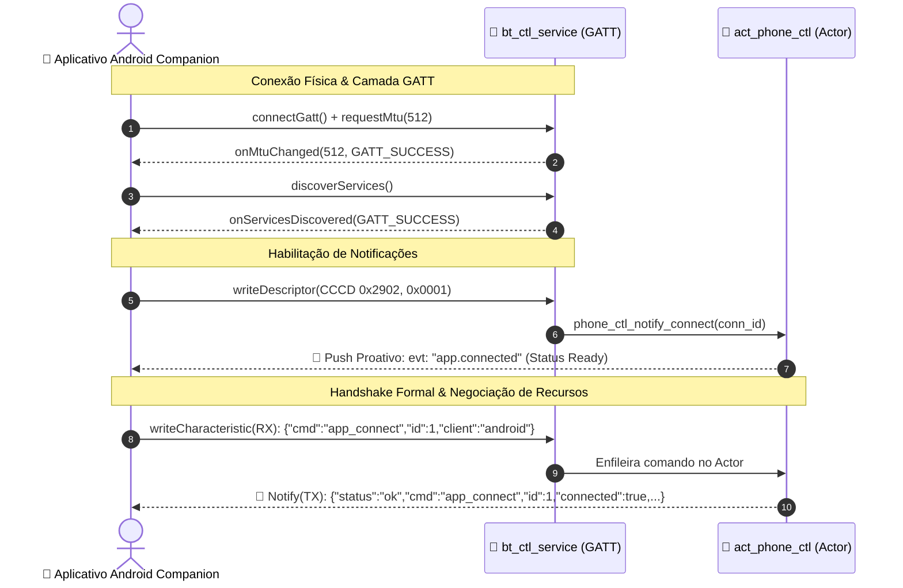

# Documentação Técnica da API BLE GATT — HeadSet4
## Guia de Integração e Especificação para Aplicativo Android Companion

> **Versão do Firmware Alvo:** ESP-IDF v6.x · FreeRTOS SMP · LVGL 9  
> **Dispositivo:** ESP32-WROVER-E (Dual-Core Xtensa LX6 + 8 MB PSRAM)  
> **Módulo Firmware Responsável:** [phone_ctl.c](file:///a:/BackupDesktopFileBruno/Estudos/ESP/ESP32/headSet4/main/src/bt/phone_ctl.c) · [bt_ctl_service.c](file:///a:/BackupDesktopFileBruno/Estudos/ESP/ESP32/headSet4/main/src/bt/bt_ctl_service.c) · [bt_eq_service.c](file:///a:/BackupDesktopFileBruno/Estudos/ESP/ESP32/headSet4/main/src/bt/bt_eq_service.c) · [bt_bas_service.c](file:///a:/BackupDesktopFileBruno/Estudos/ESP/ESP32/headSet4/main/src/bt/bt_bas_service.c)  
> **Última Atualização:** Outubro de 2026  
> **Objetivo:** Especificação técnica e exaustiva de todos os serviços GATT, características, protocolo JSON bidirecional, dicionário de eventos de telemetria, mapeamento 1:1 com as 11 telas do display e diretrizes de concorrência e segurança para o desenvolvimento do app Android companion.

---

## 1. Visão Geral da Arquitetura de Comunicação BLE

O **HeadSet4** opera simultaneamente em topologia **Dual-Mode**:
1. **Bluetooth Classic (BR/EDR):** Streaming estéreo de alta fidelidade A2DP Sink (SBC), controle de mídia AVRCP Controller/Target (Absolute Volume, Passthrough, Cover Art BIP) e chamadas telefônicas HFP Hands-Free (CVSD/mSBC com Voice NR).
2. **Bluetooth Low Energy (BLE):** Telemetria em tempo real, controle remoto bidirecional via JSON, equalização de hardware de 5 bandas, serviço de bateria SIG e suporte a pareamento rápido (Google Fast Pair e Microsoft Swift Pair).

```
+-------------------------------------------------------------------------------+
|                      APLICATIVO ANDROID (COMPANION APP)                       |
+---------------------------------------+---------------------------------------+
                                        | BLE GATT (Link Criptografado SMP)
+=======================================V=======================================+
| SERVIÇOS GATT EXPOSTOS NO FIRMWARE                                            |
|                                                                               |
| 1. Serviço de Controle & Telemetria     (UUID Custom: 5E0A1C00-4D2F-...)      |
|    ├── Char RX (Comandos JSON - Write Encrypted, buffer 512B)                 |
|    └── Char TX (Respostas & Telemetria - Notify + CCCD 0x2902)                |
|                                                                               |
| 2. Serviço de Equalizador de Hardware   (UUID Custom: 5E0A1B00-4D2F-...)      |
|    ├── Char Preset (Read / Write: 0=Flat, 1=Bass, 2=Vocal, 3=Treble)          |
|    └── Char Band Gains (Read / Write: 5 bandas x int8, passos de 0.5 dB)      |
|                                                                               |
| 3. Serviço de Bateria Padrão SIG        (UUID 0x180F)                         |
|    └── Char Battery Level (UUID 0x2A19: Read / Notify 0..100%, 2 conexões)    |
|                                                                               |
| 4. Google Fast Pair Service (GFPS)     (UUID 0xFE2C)                         |
|    └── Descoberta por Pop-up nativo do Google Play Services (Key-based / SSP) |
+=======================================+=======================================+
                                        | Despacho Interno (hs_actor_send)
+=======================================V=======================================+
| ATORES E SUBSISTEMAS DO ESP32 (Arquitetura Event-Driven & Actor Model)        |
|  [act_phone_ctl] ──> [act_audio] | [act_bt_link] | [act_settings] | [actuators]  |
+-------------------------------------------------------------------------------+
```

### 1.1 Parâmetros de Conexão e Descoberta (Advertising Dinâmico)
O firmware ajusta os parâmetros de anúncio BLE dinamicamente com base no estado operacional do headset ([bt_ble.c](file:///a:/BackupDesktopFileBruno/Estudos/ESP/ESP32/headSet4/main/src/bt/bt_ble.c)):
- **Nome Anunciado (Complete / Shortened Local Name):** `"HeadSet4"` (ou configurado pelo usuário na Flash NVS).
- **Intervalos de Anúncio por Perfil:**
  - *Modo Pareamento (`BT_BLE_ADV_PAIRING`):* 80 ms a 100 ms (janela de 120 s para descoberta instantânea).
  - *Modo Ativo / Conectado (`BT_BLE_ADV_ACTIVE`):* 500 ms a 620 ms.
  - *Modo Streaming A2DP:* 2,0 s (preservação do throughput dos pacotes de áudio SBC no rádio compartilhado).
  - *Modo Repouso / Standby (`BT_BLE_ADV_SLEEP`):* 1,28 s (economia profunda de energia).
- **Negociação de MTU:** O firmware aceita MTU estendido de até **512 bytes**. O app Android deve obrigatoriamente chamar `gatt.requestMtu(512)` logo após conectar (`onConnectionStateChange`) para viabilizar envio e recebimento de payloads JSON em pacote único sem fragmentação.

### 1.3 Sequência de Conexão, Autenticação e Handshake Bidirecional

Para que o aplicativo Android tenha certeza absoluta de que a conexão foi homologada e que o canal BLE de comandos está ativo e seguro, o sistema adota um fluxo de handshake de duas etapas:



1. **Confirmação Proativa de Boas-Vindas (`evt: "app.connected"`):**
   - Disparado automaticamente pelo headset no exato instante em que o aplicativo grava `0x0001` no descritor CCCD (`0x2902`) da característica TX (`5E0A1C02-...`).
   - O payload informa que o canal de notificação está operacional:
     ```json
     {"evt":"app.connected","data":{"status":"ready","name":"HeadSet4","fw_version":"1.0.0","api_version":1,"mtu":512}}
     ```
2. **Handshake Explícito do Aplicativo (`cmd: "app_connect"`):**
   - O aplicativo se identifica formalmente enviando sua versão e plataforma.
   - O headset valida a comunicação bidirecional e responde confirmando a conexão com os recursos suportados de hardware (`features`).

---

## 2. Mapa Completo de Serviços e Características GATT

Todos os UUIDs de 128-bits utilizam a base proprietária `5E0A1Cxx-4D2F-4A7B-9C31-0E5F2A6B7C8D`.

| Serviço | UUID | Descrição | Implementação C |
| :--- | :--- | :--- | :--- |
| **Controle & Telemetria** | `5E0A1C00-4D2F-4A7B-9C31-0E5F2A6B7C8D` | Canal bidirecional de comandos JSON e telemetria push | [bt_ctl_service.c](file:///a:/BackupDesktopFileBruno/Estudos/ESP/ESP32/headSet4/main/src/bt/bt_ctl_service.c) |
| **Equalizador Paramétrico** | `5E0A1B00-4D2F-4A7B-9C31-0E5F2A6B7C8D` | Controle direto de hardware das 5 bandas do codec WM8960 | [bt_eq_service.c](file:///a:/BackupDesktopFileBruno/Estudos/ESP/ESP32/headSet4/main/src/bt/bt_eq_service.c) |
| **Battery Service (BAS)** | `0000180F-0000-1000-8000-00805F9B34FB` (`0x180F`) | Serviço padrão Bluetooth SIG para indicador de bateria nativo | [bt_bas_service.c](file:///a:/BackupDesktopFileBruno/Estudos/ESP/ESP32/headSet4/main/src/bt/bt_bas_service.c) |
| **Google Fast Pair (GFPS)** | `0000FE2C-0000-1000-8000-00805F9B34FB` (`0xFE2C`) | Serviço para pop-up de pareamento rápido e Account Keys | [bt_fastpair.c](file:///a:/BackupDesktopFileBruno/Estudos/ESP/ESP32/headSet4/main/src/bt/bt_fastpair.c) |

---

### 2.1 Detalhamento das Características

#### Serviço 1: Controle e Telemetria (`5E0A1C00-...`)

| Característica | UUID | Propriedades | Permissões | Detalhes & Formato |
| :--- | :--- | :--- | :--- | :--- |
| **Comando (RX)** | `5E0A1C01-4D2F-4A7B-9C31-0E5F2A6B7C8D` | `WRITE` | `PERM_WRITE_ENCRYPTED` | Strings em formato **JSON** (até 512 bytes). Comandos enviados do App para o fone. Suporta Long Write. |
| **Telemetria/Resposta (TX)**| `5E0A1C02-4D2F-4A7B-9C31-0E5F2A6B7C8D` | `NOTIFY`, `READ` | `PERM_READ` | Strings em formato **JSON**. Respostas aos comandos e notificações assíncronas do fone. |
| **CCCD da Telemetria** | `00002902-0000-1000-8000-00805F9B34FB` (`0x2902`) | `READ`, `WRITE` | `PERM_READ \| WRITE` | Escrever `0x0001` (`[0x01, 0x00]`) para habilitar notificações. |

#### Serviço 2: Equalizador Paramétrico de Hardware (`5E0A1B00-...`)

| Característica | UUID | Propriedades | Permissões | Formato de Dados |
| :--- | :--- | :--- | :--- | :--- |
| **Preset de EQ** | `5E0A1B01-4D2F-4A7B-9C31-0E5F2A6B7C8D` | `READ`, `WRITE` | `READ \| WRITE` | **1 byte (`uint8_t`):**<br>`0`: Flat (Neutro/Desativado)<br>`1`: Bass Boost (Reforço de graves)<br>`2`: Vocal Boost (Reforço de médios)<br>`3`: Treble Boost (Reforço de agudos)<br>`255` (`0xFF`): Modo Customizado |
| **Band Gains (5 Bandas)** | `5E0A1B02-4D2F-4A7B-9C31-0E5F2A6B7C8D` | `READ`, `WRITE` | `READ \| WRITE` | **5 bytes (`int8_t[5]`):**<br>Ganhos das 5 bandas em passos de **0,5 dB** (-24 a +24, correspondente a **-12 dB a +12 dB**).<br>Ao escrever nesta característica, o preset muda automaticamente para Custom (`0xFF`). |

**Topologia das 5 Bandas do Hardware WM8960:**
1. **Banda 1 (Low Shelf):** Corte ~100 Hz (Graves profundos / Sub-bass).
2. **Banda 2 (Peak):** Central ~300 Hz (Corpo vocal / Médios-graves).
3. **Banda 3 (Peak):** Central ~1 kHz (Clareza de voz / Médios centrais).
4. **Banda 4 (Peak):** Central ~3 kHz (Articulação / Médios-altos).
5. **Banda 5 (High Shelf):** Corte ~8 kHz a 12 kHz (Brilho / Ar / Agudos).

#### Serviço 3: Battery Service Padrão SIG (`0x180F`)

| Característica | UUID | Propriedades | Permissões | Formato de Dados |
| :--- | :--- | :--- | :--- | :--- |
| **Battery Level** | `00002A19-0000-1000-8000-00805F9B34FB` (`0x2A19`) | `READ`, `NOTIFY` | `PERM_READ` | **1 byte (`uint8_t`):** Nível de 0 a 100%. Integrado nativamente ao painel do Android. Suporta até 2 conexões simultâneas (`BAS_MAX_CONN = 2`). |
| **CCCD da Bateria** | `00002902-0000-1000-8000-00805F9B34FB` (`0x2902`) | `READ`, `WRITE` | `PERM_READ \| WRITE` | Escrever `0x0001` para receber notificações a cada atualização do ADC. |

---

## 3. Protocolo JSON de Mensagens

Todas as comunicações no canal de Controle (`5E0A1C01` / `5E0A1C02`) utilizam JSON delimitado por quebra de linha (`\n`) ou pelo fechamento de chaves (`}`). O protocolo é estritamente tipado, determinístico e imune a condições de corrida graças ao suporte a Correlation ID (`id`).

### 3.1 Padrão de Requisição (`App -> Fone`)
```json
{
  "cmd": "<nome_do_comando>",
  "id": 101,
  "<param1>": <valor>,
  ...
}\n
```
- `cmd` *(obrigatório, string)*: Identificador da operação a ser executada.
- `id` *(opcional, número ou string)*: Correlation ID ou Transaction Tag único gerado pelo app. Quando enviado, o headset **obrigatoriamente ecoa o mesmo `id`** na resposta (seja ela de sucesso ou erro), permitindo ao Android resolver Promises/CompletableDeferred de forma imediata sem ambiguidade.
- Parâmetros adicionais (`val`, `enable`, `slot`, etc.): Conforme especificado para cada comando.

### 3.2 Padrão de Confirmação de Sucesso (`Fone -> App`)
```json
{
  "status": "ok",
  "cmd": "<nome_do_comando>",
  "id": 101,
  "<campo_confirmado>": <valor_aplicado>,
  ...
}
```
- `status`: Sempre `"ok"`.
- `cmd`: Nome do comando executado.
- `id`: Eco exato do identificador enviado na requisição (se houver).
- Campos adicionais: Confirmação com eco dos valores aceitos e configurados no hardware (ex: `"val": 75` em `set_volume`, `"slot": 1` em `select_slot`).

### 3.3 Padrão de Erro ou Rejeição (`Fone -> App`)
```json
{
  "status": "error",
  "cmd": "<nome_do_comando>",
  "id": 101,
  "reason": "<codigo_do_erro>",
  "detail": "<descricao_legivel_do_motivo>"
}
```
- `status`: Sempre `"error"`.
- `cmd`: Nome do comando rejeitado.
- `id`: Eco do `id` do comando rejeitado (se houver).
- `reason`: Código de máquina padronizado indicando o tipo de falha.
- `detail`: Descrição explicativa para facilitar diagnóstico durante o desenvolvimento e nos logs.

### 3.4 Tabela Canônica de Códigos de Erro (`reason`)

| Código `reason` | Descrição Técnica | Exemplo de Causa no App |
| :--- | :--- | :--- |
| `invalid_json` | Erro de sintaxe JSON | JSON malformado, chaves abertas, aspas faltando |
| `missing_cmd` | Chave `"cmd"` ausente ou nula | `{ "val": 80 }` enviado sem `"cmd"` |
| `unknown_cmd` | Comando não reconhecido pelo firmware | `{ "cmd": "ajustar_bass" }` ao invés de `set_eq_preset` |
| `missing_arg` | Parâmetro obrigatório omitido | `set_volume` sem passar o parâmetro `"val"` |
| `invalid_type` | Tipo de dado incompatível | Enviar `"val": "alto"` quando esperado número inteiro |
| `out_of_range` | Valor numérico além dos limites de hardware | `set_volume` com `val: 120` (limite é 0..100) |
| `invalid_args` | Argumentos compostos inconsistentes | Array `gains` com quantidade diferente de 5 bandas |
| `actor_unavailable`| Ator FreeRTOS destino indisponível | Falha temporária no enfileiramento interno |
| `no_session` | Operação exige sessão prévia ativa | Envio de `media_chunk` sem chamar `media_upload_start` |
| `incomplete_data` | Faltam bytes para completar o upload | Chamar `media_upload_finish` antes de enviar todos os chunks |
| `crc_mismatch` | Falha na verificação de integridade CRC32 | Arquivo corrompido durante o transporte BLE |
| `no_mem` | Memória insuficiente para alocação | Falha de alocação de buffer na PSRAM |
| `fastpair_disabled`| Subsistema de Fast Pair desativado | Leitura ou escrita de Model ID com módulo desabilitado |

### 3.5 Padrão de Evento de Telemetria Push (`Fone -> App`)
Transmitido automaticamente via GATT Notify quando ocorrem alterações físicas ou de estado no fone (independentemente de requisição prévia):
```json
{
  "evt": "<categoria>.<nome_do_evento>",
  "data": { ... }
}
```

---

## 4. Dicionário Completo de Telemetria (Eventos Publicados)

O firmware implementa *throttling* adaptativo de 500 ms (`NOTIFY_THROTTLE_MS = 500`) para rajadas de atualizações, assegurando estabilidade do canal de rádio BLE.

### 4.1 Eventos de Sensores e Hardware (`evt: "sensor.*"`)

#### 1. Fone Colocado na Cabeça (`sensor.worn`)
Publicado instantaneamente pelo sensor óptico infravermelho APDS-9930 quando o usuário coloca o headset:
```json
{
  "evt": "sensor.worn",
  "data": {
    "worn": true
  }
}
```

#### 2. Fone Retirado da Cabeça (`sensor.removed`)
Publicado quando o headset é retirado (dispara auto-pause de áudio no fone e corte de backlight):
```json
{
  "evt": "sensor.removed",
  "data": {
    "worn": false
  }
}
```

#### 3. Telemetria Detalhada de Bateria (`sensor.battery`)
Publicado periodicamente ou a cada alteração de degrau medido no conversor ADC1 com calibração por curva Li-Ion:
```json
{
  "evt": "sensor.battery",
  "data": {
    "pct": 87,
    "mv": 3980,
    "chg": false
  }
}
```
- `pct`: Nível percentual de carga (0 a 100%).
- `mv`: Tensão real da célula Li-Ion em milivolts (ex: 3980 mV = 3,98 V).
- `chg`: Booleano indicador de carregador USB conectado (`true` carregando, `false` descarregando).

---

### 4.2 Eventos de Bluetooth & Multiponto (`evt: "bt.*"`)

#### 1. Conexão Estabelecida (`bt.link_up`)
```json
{
  "evt": "bt.link_up",
  "data": {
    "slot": 0,
    "status": "connected"
  }
}
```
- `slot`: Índice do slot conectado (`0` = Dispositivo 1, `1` = Dispositivo 2).

#### 2. Desconexão de Link (`bt.link_down`)
```json
{
  "evt": "bt.link_down",
  "data": {
    "slot": 1,
    "status": "disconnected"
  }
}
```

#### 3. Mudança de Slot Ativo (`bt.slot_changed`)
Publicado quando o fone comuta o dispositivo que tem prioridade de áudio:
```json
{
  "evt": "bt.slot_changed",
  "data": {
    "active_slot": 0
  }
}
```

#### 4. Nome do Dispositivo Conectado (`bt.peer_name`)
Transmitido assim que o protocolo GAP / SDP resolve o nome amigável do smartphone ou computador pareado:
```json
{
  "evt": "bt.peer_name",
  "data": {
    "slot": 0,
    "name": "Galaxy S23 Ultra"
  }
}
```

---

### 4.3 Eventos de Áudio & Volume (`evt: "audio.*"`)

#### 1. Volume Master Alterado (`audio.volume`)
Disparado se o volume for ajustado no display touch, pelo botão físico ou pelo smartphone via AVRCP:
```json
{
  "evt": "audio.volume",
  "data": {
    "vol": 72,
    "mute": false
  }
}
```
- `vol`: Volume em escala linear perceptual de 0 a 100%.
- `mute`: `true` se áudio mutado no codec de hardware.

#### 2. Mudança de Modo de Áudio (`audio.mode`)
```json
{
  "evt": "audio.mode",
  "data": {
    "mode": 1,
    "rate": 44100
  }
}
```
- `mode`: Modo operacional do DSP de áudio:
  - `0`: IDLE (Repouso, codec em baixo consumo).
  - `1`: MUSIC_A2DP (Streaming estéreo de música).
  - `2`: CALL_HFP (Chamada telefônica de voz bidirecional com Voice NR ativado).
  - `3`: TONE_SFX (Efeito sonoro do sistema ou bipe).
- `rate`: Frequência de amostragem do barramento I2S em Hz (ex: 44100 Hz, 48000 Hz ou 16000 Hz em chamadas HD mSBC).

---

### 4.4 Eventos de Configuração Persistida (`evt: "cfg.*"`)

#### Parâmetro Alterado no NVS Flash (`cfg.changed`)
Publicado sempre que uma preferência do sistema é salva pelo motor de configurações:
```json
{
  "evt": "cfg.changed",
  "data": {
    "key": "disp_bright",
    "val": 75
  }
}
```
Chaves conhecidas: `disp_bright`, `disp_to`, `disp_img_idx`, `disp_gif_idx`, `sens_prox_en`, `vib_en`, `vib_intens`, `ears_angle`, `bt_autosw`.

---

### 4.5 Eventos de Seleção de Mídia e Galeria (`evt: "display.*"`)

#### 1. Papel de Parede Alterado no Headset (`display.wallpaper_changed`)
Publicado sempre que o usuário toca em um dos botões da galeria na tela [screen_galeria_imagens](file:///a:/BackupDesktopFileBruno/Estudos/ESP/ESP32/headSet4/components/ui/screens/screen_galeria_imagens.xml):
```json
{
  "evt": "display.wallpaper_changed",
  "data": {
    "active_idx": 2,
    "name": "Cyberpunk"
  }
}
```

#### 2. GIF Animado Alterado no Headset (`display.gif_changed`)
Publicado sempre que o usuário toca em um dos botões da galeria na tela [screen_galeria_gifs](file:///a:/BackupDesktopFileBruno/Estudos/ESP/ESP32/headSet4/components/ui/screens/screen_galeria_gifs.xml):
```json
{
  "evt": "display.gif_changed",
  "data": {
    "active_idx": 1,
    "name": "Pulso Eletrico"
  }
}
```


---

## 5. Mapeamento 1:1 entre as 11 Telas do Display e a API do App

Toda tela navegável no display LCD TFT de 2,8" possui comandos correspondentes no protocolo JSON para garantir paridade absoluta entre a interface do fone e o app Android.

```
+-----------------------------------------------------------------------------------+
| MAPEAMENTO: DISPLAY DO HEADSET  <=======>  API BLE DO APLICATIVO ANDROID         |
+--------------------+------------------------------+-------------------------------+
| Tela do Display    | Informação / Controle Físico | Comando JSON / Método GATT    |
+--------------------+------------------------------+-------------------------------+
| Conexão Inicial    | Handshake e Negociação       | cmd: "app_connect"            |
| screen_status      | Snapshot completo do sistema | cmd: "get_all_status"         |
| screen_bluetooth   | Status slots 1 e 2           | Telemetria bt.link_up/down    |
| screen_bluetooth   | Desconectar Dispositivo 1    | cmd: "disconnect_slot",slot:0 |
| screen_bluetooth   | Desconectar Dispositivo 2    | cmd: "disconnect_slot",slot:1 |
| screen_bluetooth   | Alternar Slot de Áudio Ativo | cmd: "select_slot",slot:0/1   |
| screen_bluetooth   | Abrir Pareamento (120s)      | cmd: "start_pairing"          |
| screen_proximidade | Ativar/Desativar APDS-9930   | cmd: "set_prox_enable"        |
| screen_proximidade | Slider Sensibilidade (0-1023)| cmd: "set_prox_sensitivity"   |
| screen_vibracall   | Ativar/Desativar Háptica     | cmd: "set_vibracall"          |
| screen_vibracall   | Slider Intensidade (0-100%)  | cmd: "set_vibracall",val:XX   |
| screen_vibracall   | Notificação / Teste Vibração | cmd: "trigger_vibrate"        |
| screen_orelhas     | Ativar/Desativar Servomotores| cmd: "set_ears_enable"        |
| screen_orelhas     | Slider Ângulo (0 a 180 graus)| cmd: "set_ears_angle",val:XX  |
| screen_display     | Ligar/Desligar LCD (Sleep)   | cmd: "set_display_state"      |
| screen_display     | Slider Brilho Backlight PWM  | cmd: "set_brightness",val:XX  |
| screen_display     | Timeout de Tela (segundos)   | cmd: "set_display_timeout"    |
| screen_galeria_img | Papel de Parede Ativo (Idx)  | cmd: "set_wallpaper_idx"      |
| screen_galeria_gif | Animação GIF Ativa (Idx)     | cmd: "set_gif_idx"            |
| screen_settings    | Volume Master (0 a 100%)     | cmd: "set_volume",val:XX      |
| screen_settings    | Mudo do Codec (true/false)   | cmd: "set_mute",mute:XX       |
| screen_settings    | Equalizador 5 Bandas         | cmd: "set_eq_preset"/"gains"  |
| screen_settings    | Google Fast Pair Model ID    | cmd: "get/set_model_id"       |
+--------------------+------------------------------+-------------------------------+
```

---

## 6. Catálogo Detalhado de Comandos JSON (App -> HeadSet4)

### 6.0 Handshake de Conexão do Companion App: `app_connect`
Enviado pelo aplicativo logo após descobrir os serviços GATT e habilitar as notificações no CCCD. Confirma o enlace bidirecional e retorna as funcionalidades suportadas pelo hardware.

**Envio do App:**
```json
{"cmd": "app_connect", "id": 1, "app_version": "1.0.0", "client": "android"}\n
```

**Confirmação do Headset (Sucesso):**
```json
{
  "status": "ok",
  "cmd": "app_connect",
  "id": 1,
  "connected": true,
  "headset": "HeadSet4",
  "fw_version": "1.0.0",
  "api_version": 1,
  "features": ["eq5", "media_upload", "dual_slot", "haptics", "proximity"]
}
```

---

### 6.1 Consulta Global de Estado: `get_all_status`
Solicita instantaneamente um snapshot completo de todas as variáveis do modelo de dados (`ui_model`).

**Envio do App:**
```json
{"cmd": "get_all_status", "id": 2}\n
```

**Resposta do Headset (Sucesso):**
```json
{
  "status": "ok",
  "cmd": "get_all_status",
  "id": 2,
  "bt1": "Galaxy S23 Ultra",
  "bt2": "Notebook Dell",
  "st1": "Conectado",
  "st2": "Desconectado",
  "alt": true,
  "prox": "worn",
  "bat": 92,
  "disp": true,
  "brilho": 80,
  "vol": 65,
  "img": 0,
  "gif": 0
}
```

---

### 6.2 Controle de Áudio, Volume e Mídia (AVRCP)

#### 1. Ajustar Volume Master: `set_volume`
Ajusta linearmente o ganho do codec WM8960 e atualiza o display:
```json
{"cmd": "set_volume", "id": 3, "val": 75}\n
```
- `val`: Número inteiro de `0` a `100`.

**Confirmação do Headset (Sucesso):**
```json
{"status": "ok", "cmd": "set_volume", "id": 3, "val": 75}
```
**Rejeição / Erro (ex: parâmetro ausente ou fora de faixa):**
```json
{"status": "error", "cmd": "set_volume", "id": 3, "reason": "out_of_range", "detail": "val must be between 0 and 100"}
```

#### 2. Mutar ou Desmutar Áudio: `set_mute`
```json
{"cmd": "set_mute", "id": 4, "mute": true}\n
```
- `mute`: `true` para mutar o codec, `false` para desmutar.

**Confirmação do Headset (Sucesso):**
```json
{"status": "ok", "cmd": "set_mute", "id": 4, "mute": true}
```
**Rejeição / Erro:**
```json
{"status": "error", "cmd": "set_mute", "id": 4, "reason": "invalid_type", "detail": "mute must be boolean"}
```

#### 3. Controle de Reprodução Multimídia (AVRCP Passthrough)
Permite ao app Android enviar ordens de transporte de mídia que são despachadas via AVRCP para o reprodutor ativo do smartphone ou computador conectado via Bluetooth Classic:

- **Play/Pause Toggle:**
  ```json
  {"cmd": "media_play_pause", "id": 5}\n
  ```
  *Resposta:* `{"status":"ok","cmd":"media_play_pause","id":5,"action":"play_pause"}`

- **Play (Iniciar Reprodução):**
  ```json
  {"cmd": "media_play", "id": 6}\n
  ```
  *Resposta:* `{"status":"ok","cmd":"media_play","id":6,"action":"play"}`

- **Pause (Pausar Reprodução):**
  ```json
  {"cmd": "media_pause", "id": 7}\n
  ```
  *Resposta:* `{"status":"ok","cmd":"media_pause","id":7,"action":"pause"}`

- **Próxima Faixa (Next Track):**
  ```json
  {"cmd": "media_next", "id": 8}\n
  ```
  *Resposta:* `{"status":"ok","cmd":"media_next","id":8,"action":"next"}`

- **Faixa Anterior (Previous Track):**
  ```json
  {"cmd": "media_prev", "id": 9}\n
  ```
  *Resposta:* `{"status":"ok","cmd":"media_prev","id":9,"action":"prev"}`

---

### 6.3 Controle de Conexões Bluetooth Multiponto

#### 1. Selecionar Slot de Áudio Ativo: `select_slot`
Define qual dos dispositivos pareados enviará áudio para o fone:
```json
{"cmd": "select_slot", "id": 10, "slot": 0}\n
```
- `slot`: `0` para Slot 1, `1` para Slot 2.

**Confirmação do Headset (Sucesso):**
```json
{"status": "ok", "cmd": "select_slot", "id": 10, "slot": 0}
```
**Rejeição / Erro:**
```json
{"status": "error", "cmd": "select_slot", "id": 10, "reason": "out_of_range", "detail": "slot must be 0 or 1"}
```

#### 2. Desconectar Slot Manualmente: `disconnect_slot`
Equivalente a tocar no botão "Desconectar" na tela `screen_bluetooth`:
```json
{"cmd": "disconnect_slot", "id": 11, "slot": 1}\n
```

**Confirmação do Headset (Sucesso):**
```json
{"status": "ok", "cmd": "disconnect_slot", "id": 11, "slot": 1, "disconnected": true}
```
**Rejeição / Erro:**
```json
{"status": "error", "cmd": "disconnect_slot", "id": 11, "reason": "out_of_range", "detail": "slot must be 0 or 1"}
```

#### 3. Iniciar Modo de Pareamento: `start_pairing`
Abre visibilidade e descoberta Bluetooth Classic e BLE por 120 segundos para conectar novo dispositivo:
```json
{"cmd": "start_pairing", "id": 12}\n
```

**Confirmação do Headset (Sucesso):**
```json
{"status": "ok", "cmd": "start_pairing", "id": 12, "duration_sec": 120, "pairing": true}
```

#### 4. Alternar Troca Automática Inteligente: `set_auto_switch`
Ativa ou desativa o recurso que comuta o slot automaticamente ao receber chamadas telefônicas:
```json
{"cmd": "set_auto_switch", "id": 13, "enable": true}\n
```

**Confirmação do Headset (Sucesso):**
```json
{"status": "ok", "cmd": "set_auto_switch", "id": 13, "enable": true}
```
**Rejeição / Erro:**
```json
{"status": "error", "cmd": "set_auto_switch", "id": 13, "reason": "invalid_type", "detail": "enable must be boolean"}
```

---

### 6.4 Controle de Display & Iluminação

#### 1. Ajustar Brilho do Display: `set_brightness`
Ajusta o ciclo de trabalho do PWM LEDC de 5 kHz no GPIO 13 com curva perceptual quadrática:
```json
{"cmd": "set_brightness", "id": 14, "val": 70}\n
```
- `val`: `0` a `100`%.

**Confirmação do Headset (Sucesso):**
```json
{"status": "ok", "cmd": "set_brightness", "id": 14, "val": 70}
```
**Rejeição / Erro:**
```json
{"status": "error", "cmd": "set_brightness", "id": 14, "reason": "out_of_range", "detail": "val must be between 0 and 100"}
```

#### 2. Ligar ou Desligar Display (Modo Sleep): `set_display_state`
Suspende a renderização do display e desliga o backlight para economia máxima de bateria:
```json
{"cmd": "set_display_state", "id": 15, "enable": false}\n
```

**Confirmação do Headset (Sucesso):**
```json
{"status": "ok", "cmd": "set_display_state", "id": 15, "enable": false}
```
**Rejeição / Erro:**
```json
{"status": "error", "cmd": "set_display_state", "id": 15, "reason": "invalid_type", "detail": "enable must be boolean"}
```

#### 3. Tempo de Inatividade de Tela: `set_display_timeout`
Configura o tempo em segundos até a tela diminuir o brilho e suspender:
```json
{"cmd": "set_display_timeout", "id": 16, "val": 30}\n
```
- `val`: Segundos (`0` = tela sempre acesa, `15`, `30`, `60`, etc.).

**Confirmação do Headset (Sucesso):**
```json
{"status": "ok", "cmd": "set_display_timeout", "id": 16, "val": 30}
```
**Rejeição / Erro:**
```json
{"status": "error", "cmd": "set_display_timeout", "id": 16, "reason": "out_of_range", "detail": "val must be >= 0"}
```

---

### 6.5 Controle do Sensor de Proximidade (Uso na Cabeça)

#### 1. Habilitar Detecção no Ouvido: `set_prox_enable`
```json
{"cmd": "set_prox_enable", "id": 17, "enable": true}\n
```

**Confirmação do Headset (Sucesso):**
```json
{"status": "ok", "cmd": "set_prox_enable", "id": 17, "enable": true}
```
**Rejeição / Erro:**
```json
{"status": "error", "cmd": "set_prox_enable", "id": 17, "reason": "invalid_type", "detail": "enable must be boolean"}
```

#### 2. Ajustar Limiar / Sensibilidade: `set_prox_sensitivity`
Define a contagem de reflexão infravermelha necessária para detectar contato com a orelha:
```json
{"cmd": "set_prox_sensitivity", "id": 18, "val": 160}\n
```
- `val`: Valor numérico de `0` a `1023` (Padrão: `150` a `200`). Histerese dinâmica de 40% ($th_{\text{off}} = 0{,}6 \cdot th_{\text{on}}$).

**Confirmação do Headset (Sucesso):**
```json
{"status": "ok", "cmd": "set_prox_sensitivity", "id": 18, "val": 160}
```
**Rejeição / Erro:**
```json
{"status": "error", "cmd": "set_prox_sensitivity", "id": 18, "reason": "out_of_range", "detail": "val must be between 0 and 1023"}
```

---

### 6.6 Atuador Háptico (Vibracall) & Notificações do Smartphone

#### 1. Configurar Habilitação e Intensidade Padrão: `set_vibracall`
```json
{"cmd": "set_vibracall", "id": 19, "enable": true, "val": 85}\n
```
- `enable`: `true` ou `false` (opcional).
- `val`: Intensidade PWM de `0` a `100`% (opcional).

**Confirmação do Headset (Sucesso):**
```json
{"status": "ok", "cmd": "set_vibracall", "id": 19, "enable": true, "val": 85}
```
**Rejeição / Erro:**
```json
{"status": "error", "cmd": "set_vibracall", "id": 19, "reason": "missing_arg", "detail": "enable or val is required"}
```

#### 2. Disparar Vibração por Notificação Remota: `trigger_vibrate` ou `notification`
Permite que o aplicativo Android dispare envelopes de vibração no fone quando o smartphone receber mensagens ou alertas (WhatsApp, SMS, Chamada, Alarme):
```json
{
  "cmd": "trigger_vibrate",
  "id": 20,
  "duration_ms": 300,
  "intensity": 90
}\n
```
- `duration_ms`: Duração do pulso em milissegundos (ex: 200 ms clique, 800 ms alarme).
- `intensity`: Intensidade PWM (`0` a `100`%). Se `0`, utiliza a intensidade salva.

**Confirmação do Headset (Sucesso):**
```json
{"status": "ok", "cmd": "trigger_vibrate", "id": 20, "vibrated": true, "duration_ms": 300, "intensity": 90}
```

---

### 6.7 Servomotores das Orelhas Animatrônicas

#### 1. Habilitar / Desabilitar Movimento das Orelhas: `set_ears_enable`
```json
{"cmd": "set_ears_enable", "id": 21, "enable": true}\n
```

**Confirmação do Headset (Sucesso):**
```json
{"status": "ok", "cmd": "set_ears_enable", "id": 21, "enable": true}
```
**Rejeição / Erro:**
```json
{"status": "error", "cmd": "set_ears_enable", "id": 21, "reason": "invalid_type", "detail": "enable must be boolean"}
```

#### 2. Ajustar Ângulo Máximo de Expressividade: `set_ears_angle`
```json
{"cmd": "set_ears_angle", "id": 22, "val": 90}\n
```
- `val`: Ângulo em graus de `0` a `180`.

**Confirmação do Headset (Sucesso):**
```json
{"status": "ok", "cmd": "set_ears_angle", "id": 22, "val": 90}
```
**Rejeição / Erro:**
```json
{"status": "error", "cmd": "set_ears_angle", "id": 22, "reason": "out_of_range", "detail": "val must be between 0 and 180"}
```

---

### 6.8 Personalização Visual (Wallpapers, Animações e Upload de Mídia)

> Para especificação detalhada de empacotamento, formatos RGB565/GIF89a e protocolo de chunking, consulte:  
> 🔗 [PROTOCOLO_TRANSFERENCIA_MIDIA_BLE.md](file:///a:/BackupDesktopFileBruno/Estudos/ESP/ESP32/headSet4/docs/PROTOCOLO_TRANSFERENCIA_MIDIA_BLE.md)

#### 1. Selecionar Papel de Parede Ativo (Principal): `set_wallpaper_idx`
```json
{"cmd": "set_wallpaper_idx", "id": 23, "val": 2}\n
```
- `val`: Índice da imagem na galeria (`0` a `5`).

**Confirmação do Headset (Sucesso):**
```json
{"status": "ok", "cmd": "set_wallpaper_idx", "id": 23, "active_img": 2}
```
**Rejeição / Erro:**
```json
{"status": "error", "cmd": "set_wallpaper_idx", "id": 23, "reason": "out_of_range", "detail": "val must be between 0 and 5"}
```

#### 2. Selecionar GIF de Standby Ativo (Principal): `set_gif_idx`
```json
{"cmd": "set_gif_idx", "id": 24, "val": 1}\n
```
- `val`: Índice do GIF animado na galeria (`0` a `5`).

**Confirmação do Headset (Sucesso):**
```json
{"status": "ok", "cmd": "set_gif_idx", "id": 24, "active_gif": 1}
```
**Rejeição / Erro:**
```json
{"status": "error", "cmd": "set_gif_idx", "id": 24, "reason": "out_of_range", "detail": "val must be between 0 and 5"}
```

#### 3. Consultar Informações da Galeria: `get_media_info`
```json
{"cmd": "get_media_info", "id": 25}\n
```
**Confirmação do Headset (Sucesso):**
```json
{
  "status": "ok",
  "cmd": "get_media_info",
  "id": 25,
  "active_img": 0,
  "active_gif": 0,
  "images": [
    {"slot": 0, "has_data": true, "name": "Default", "size": 142080},
    {"slot": 1, "has_data": false, "name": "", "size": 0},
    {"slot": 2, "has_data": false, "name": "", "size": 0},
    {"slot": 3, "has_data": false, "name": "", "size": 0},
    {"slot": 4, "has_data": false, "name": "", "size": 0},
    {"slot": 5, "has_data": false, "name": "", "size": 0}
  ],
  "gifs": [
    {"slot": 0, "has_data": true, "name": "Default", "size": 52140},
    {"slot": 1, "has_data": false, "name": "", "size": 0},
    {"slot": 2, "has_data": false, "name": "", "size": 0},
    {"slot": 3, "has_data": false, "name": "", "size": 0},
    {"slot": 4, "has_data": false, "name": "", "size": 0},
    {"slot": 5, "has_data": false, "name": "", "size": 0}
  ]
}
```

#### 4. Iniciar Upload de Novo Arquivo: `media_upload_start`
```json
{"cmd": "media_upload_start", "id": 26, "type": "image", "slot": 2, "size": 142080, "crc32": "D4E5F6A7", "name": "Cyberpunk"}\n
```
**Confirmação do Headset (Sucesso):**
```json
{"status": "ok", "cmd": "media_upload_start", "id": 26, "type": "image", "slot": 2, "chunk_size": 480}
```

#### 5. Enviar Pedaço de Dados (Chunk): `media_chunk`
```json
{"cmd": "media_chunk", "id": 27, "seq": 0, "data": "<base64_string>"}\n
```
**Confirmação do Headset (ACK):**
```json
{"status": "ack", "cmd": "media_chunk", "id": 27, "seq": 0, "received": 480, "total": 142080}
```

#### 6. Finalizar e Gravar na Memória NVS: `media_upload_finish`
```json
{"cmd": "media_upload_finish", "id": 28}\n
```
**Confirmação do Headset (Sucesso):**
```json
{"status": "ok", "cmd": "media_upload_finish", "id": 28, "type": "image", "slot": 2, "verified": true, "name": "Cyberpunk"}
```
**Rejeição / Erro (CRC divergente):**
```json
{"status": "error", "cmd": "media_upload_finish", "id": 28, "reason": "crc_mismatch", "detail": "data checksum does not match expected_crc32"}
```

#### 7. Apagar Mídia de um Slot: `delete_media_slot`
```json
{"cmd": "delete_media_slot", "id": 29, "type": "image", "slot": 2}\n
```
**Confirmação do Headset (Sucesso):**
```json
{"status": "ok", "cmd": "delete_media_slot", "id": 29, "type": "image", "slot": 2, "deleted": true}
```

---

### 6.9 Configuração do Equalizador Paramétrico (Codec WM8960)

#### 1. Selecionar Preset de EQ: `set_eq_preset`
```json
{"cmd": "set_eq_preset", "id": 30, "preset": 1}\n
```
- `preset`: `0` = Flat, `1` = Bass Boost, `2` = Vocal Boost, `3` = Treble Boost, `255` = Custom.

**Confirmação do Headset (Sucesso):**
```json
{"status": "ok", "cmd": "set_eq_preset", "id": 30, "preset": 1}
```
**Rejeição / Erro:**
```json
{"status": "error", "cmd": "set_eq_preset", "id": 30, "reason": "out_of_range", "detail": "preset must be 0..3 or 255"}
```

#### 2. Ajustar Ganhos das 5 Bandas via JSON: `set_eq_gains`
```json
{"cmd": "set_eq_gains", "id": 31, "gains": [4, 2, 0, -2, 6]}\n
```
- `gains`: Array com exatamente 5 números inteiros (-24 a +24, passos de 0.5 dB).

**Confirmação do Headset (Sucesso):**
```json
{"status": "ok", "cmd": "set_eq_gains", "id": 31, "gains": [4, 2, 0, -2, 6]}
```
**Rejeição / Erro:**
```json
{"status": "error", "cmd": "set_eq_gains", "id": 31, "reason": "invalid_args", "detail": "gains must be an array of 5 numbers (-24 to +24)"}
```

---

### 6.10 Configuração do Google Fast Pair (Model ID)

#### 1. Consultar Model ID Atual: `get_model_id`
```json
{"cmd": "get_model_id", "id": 32}\n
```
**Confirmação do Headset (Sucesso):**
```json
{"status": "ok", "cmd": "get_model_id", "id": 32, "model_id": "F52A3B"}
```

#### 2. Atualizar Model ID: `set_model_id`
```json
{"cmd": "set_model_id", "id": 33, "val": "F52A3B"}\n
```
**Confirmação do Headset (Sucesso):**
```json
{"status": "ok", "cmd": "set_model_id", "id": 33, "model_id": "F52A3B"}
```
**Rejeição / Erro:**
```json
{"status": "error", "cmd": "set_model_id", "id": 33, "reason": "invalid_len", "detail": "val must have exactly 6 hex characters (3 bytes)"}
```

---

### 6.11 Comando de Diagnóstico e Keepalive: `ping`
```json
{"cmd": "ping", "id": 34}\n
```
**Confirmação do Headset (Sucesso):**
```json
{"status": "ok", "cmd": "ping", "id": 34, "pong": true}
```

---

## 7. Considerações de Performance, Latência e Ciclo de Vida do Rádio

1. **Ciclo de Vida sob Demanda do Ator `phone_ctl`:**
   - O ator `phone_ctl` encerra sua task FreeRTOS por inatividade após 30 segundos sem cliente (`PHONE_CTL_IDLE_MS = 30000`), liberando 3584 bytes de memória RAM. Ao fechar o app, o ESP32 retorna ao modo de repouso dinâmico (PM/DFS).
2. **Coalescência de Sliders na Interface Móvel:**
   - Ao mover Sliders em Jetpack Compose (volume, brilho, equalizador, orelhas), aplique operadores de debounce de **100 ms a 150 ms** (`flow.debounce(100)`). Isso impede que rajadas de pacotes BLE saturem o buffer `s_incoming_buf` de 512 bytes e a fila do microcontrolador.
3. **Persistência Confiável no NVS Flash:**
   - O ator `act_settings` consolida escritas com debounce de **1500 ms** antes de gravar na memória Flash física, garantindo vida útil prolongada aos blocos da memória flash do ESP32.
4. **Fila Sequencial de Operações GATT no Android:**
   - A API nativa `BluetoothGatt` do Android não aceita operações paralelas concorrentes (disparar uma escrita antes da confirmação da anterior resulta em silêncio ou erro `GATT_FAILURE 133`). O app deve adotar uma **fila serializada de comandos GATT** (GattCommandQueue).

---

## 8. Arquitetura e Implementação no Aplicativo Android (Kotlin)

Para integrar de forma reativa e thread-safe com o firmware do **HeadSet4**, o aplicativo Android deve implementar um despachante de comandos baseado em **Kotlin Coroutines (`CompletableDeferred`)** e **Correlation ID**.

### 8.1 Modelos de Dados (Kotlinx Serialization)

```kotlin
package com.headset4.companion.data.ble

import kotlinx.serialization.Serializable
import kotlinx.serialization.json.JsonElement

@Serializable
data class BleCommandRequest(
    val cmd: String,
    val id: Long? = null,
    val val: Int? = null,
    val enable: Boolean? = null,
    val slot: Int? = null,
    val mute: Boolean? = null,
    val preset: Int? = null,
    val gains: List<Int>? = null,
    val duration_ms: Int? = null,
    val intensity: Int? = null,
    val client: String? = null,
    val app_version: String? = null
)

@Serializable
data class BleCommandResponse(
    val status: String,            // "ok", "error" ou "ack"
    val cmd: String? = null,
    val id: Long? = null,
    val reason: String? = null,    // Código de erro quando status == "error"
    val detail: String? = null,    // Detalhe explicativo legível
    val val: Int? = null,
    val enable: Boolean? = null,
    val slot: Int? = null,
    val muted: Boolean? = null,
    val connected: Boolean? = null,
    val headset: String? = null,
    val fw_version: String? = null,
    val api_version: Int? = null,
    val features: List<String>? = null
)

@Serializable
data class BlePushEvent(
    val evt: String,               // ex: "app.connected", "sensor.battery"
    val data: JsonElement
)
```

### 8.2 Cliente de Comandos com Confirmação Assíncrona (`BleCommandClient`)

```kotlin
package com.headset4.companion.ble

import com.headset4.companion.data.ble.BleCommandRequest
import com.headset4.companion.data.ble.BleCommandResponse
import com.headset4.companion.data.ble.BlePushEvent
import kotlinx.coroutines.CompletableDeferred
import kotlinx.coroutines.flow.MutableSharedFlow
import kotlinx.coroutines.flow.SharedFlow
import kotlinx.coroutines.flow.asSharedFlow
import kotlinx.coroutines.sync.Mutex
import kotlinx.coroutines.sync.withLock
import kotlinx.coroutines.withTimeout
import kotlinx.serialization.json.Json
import java.util.concurrent.ConcurrentHashMap
import java.util.concurrent.atomic.AtomicLong

class BleCommandClient(
    private val gattWriter: suspend (ByteArray) -> Boolean
) {
    private val json = Json { ignoreUnknownKeys = true; encodeDefaults = false }
    private val requestIdGen = AtomicLong(1)
    private val pendingRequests = ConcurrentHashMap<Long, CompletableDeferred<BleCommandResponse>>()
    private val writeLock = Mutex()

    private val _eventsFlow = MutableSharedFlow<BlePushEvent>(extraBufferCapacity = 64)
    val eventsFlow: SharedFlow<BlePushEvent> = _eventsFlow.asSharedFlow()

    /**
     * Envia um comando JSON com ID único e suspende a Coroutine até que a
     * notificação correspondente de confirmação com o mesmo 'id' seja devolvida pelo HeadSet4.
     */
    suspend fun executeCommand(
        cmd: String,
        builder: BleCommandRequest.() -> BleCommandRequest = { this },
        timeoutMs: Long = 3000L
    ): Result<BleCommandResponse> = runCatching {
        val reqId = requestIdGen.getAndIncrement()
        val deferred = CompletableDeferred<BleCommandResponse>()
        pendingRequests[reqId] = deferred

        val request = BleCommandRequest(cmd = cmd, id = reqId).builder()
        val jsonPayload = json.encodeToString(BleCommandRequest.serializer(), request) + "\n"

        writeLock.withLock {
            val success = gattWriter(jsonPayload.toByteArray(Charsets.UTF_8))
            if (!success) {
                pendingRequests.remove(reqId)
                throw IllegalStateException("Falha física ao escrever na característica GATT RX")
            }
        }

        withTimeout(timeoutMs) {
            val response = deferred.await()
            if (response.status == "error") {
                throw BleCommandRejectedException(
                    cmd = response.cmd ?: cmd,
                    reason = response.reason ?: "unknown_error",
                    detail = response.detail ?: "Sem detalhes fornecidos pelo firmware"
                )
            }
            response
        }
    }

    /**
     * Invocado quando uma notificação GATT (TX: 5E0A1C02) é recebida do HeadSet4.
     */
    fun onNotificationReceived(data: ByteArray) {
        val rawString = String(data, Charsets.UTF_8).trim()
        if (rawString.isEmpty()) return

        // 1. Verifica se é um evento push proativo (ex: "app.connected" ou "sensor.worn")
        if (rawString.contains("\"evt\"")) {
            runCatching {
                val event = json.decodeFromString(BlePushEvent.serializer(), rawString)
                _eventsFlow.tryEmit(event)
            }
            return
        }

        // 2. É uma resposta a comando (status: "ok" ou "error")
        runCatching {
            val resp = json.decodeFromString(BleCommandResponse.serializer(), rawString)
            val reqId = resp.id
            if (reqId != null && pendingRequests.containsKey(reqId)) {
                pendingRequests.remove(reqId)?.complete(resp)
            }
        }
    }

    /**
     * Executa o Handshake Formal de Conexão.
     */
    suspend fun performHandshake(appVersion: String): Result<BleCommandResponse> {
        return executeCommand("app_connect") {
            copy(client = "android", app_version = appVersion)
        }
    }
}

class BleCommandRejectedException(
    val cmd: String,
    val reason: String,
    val detail: String
) : Exception("Comando [$cmd] rejeitado pelo HeadSet4: reason=$reason ($detail)")
```

